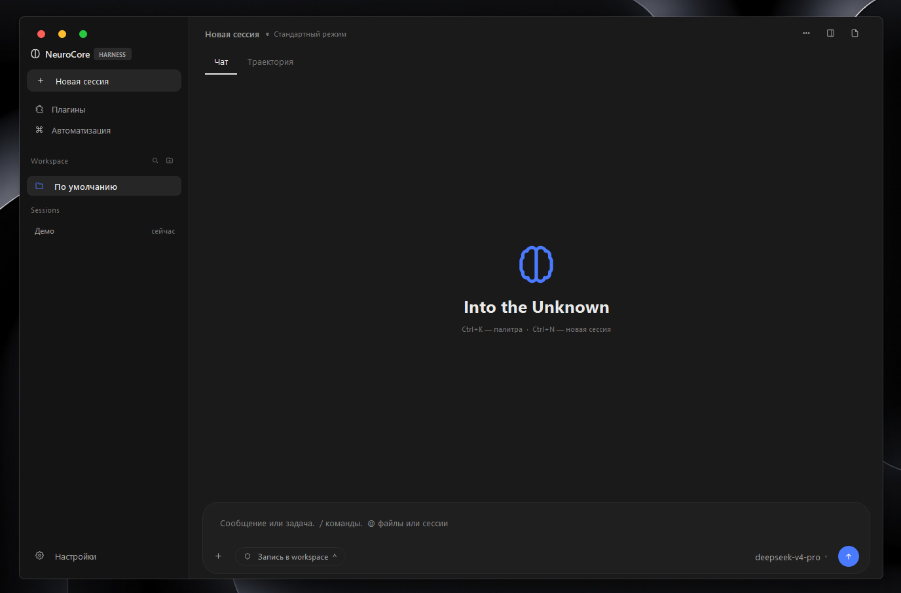
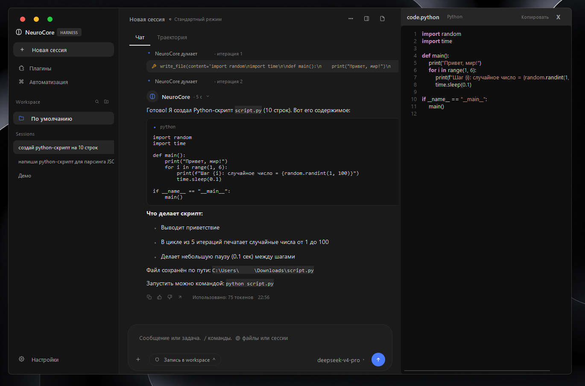
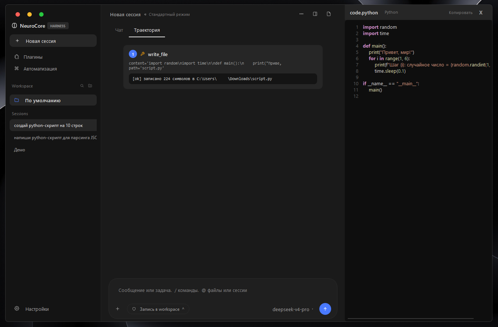
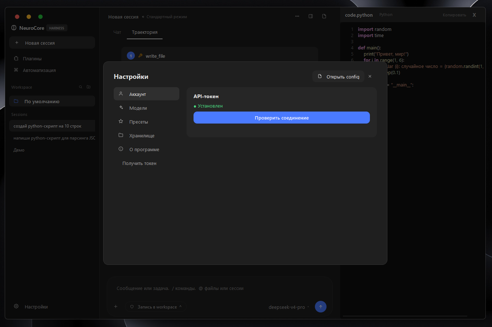

# 🧠 NeuroCore

> Автономный AI-агент на базе DeepSeek. 129 инструментов. Нативный GUI.

## ✨ Возможности

- 💬 **Чат с DeepSeek** — V4 Pro / Flash / Reasoner
- 🛠️ **129 инструментов** — файлы, shell, интернет, GUI-контроль, браузер, БД, данные
- 📝 **Code Panel** — живая панель кода справа (как в Cursor/Codex):
  подсветка синтаксиса, номера строк, авто-открытие файлов
- 🔍 **DeepSeek Search** — встроенный поиск на Flash (3 сек)
- 🖥️ **Управление ПК** — скриншоты, клики, окна (pyautogui)
- 🌐 **Автоматизация браузера** — Playwright + Chrome
- 🎨 **Генерация картинок** — Pollinations (бесплатно)
- 🔐 **Авто-токен** — забирает userToken из Chrome
- 📁 **Многосессионный чат** — история сохраняется
- 🎭 **Три режима доступа** — только чтение / workspace / полный
- ⚙️ **Папка сохранения** — файлы агента в выбранной директории
- 🤖 **Roblox автоплей** — агент играет сам
- 📊 **SQLite, CSV, JSON, YAML, XML** — работа с данными
- 📄 **Word, PDF, Excel** — чтение документов
- 🔐 **Криптография** — хеши, HMAC, пароли
- 🪟 **Система Windows** — реестр, службы, задачи
- ⌨️ **Палитра команд** — Ctrl+K

## 📸 Скриншоты

### Чат и Code Panel

Слева — диалог с агентом. Справа — панель кода с подсветкой,
которая **автоматически открывает файлы**, созданные агентом.

### Вкладка «Траектория»

Все вызовы инструментов пошагово: что вызвано, с какими аргументами,
какой результат вернул.

### Настройки

- **Аккаунт** — токен DeepSeek
- **Модели** — что показывать в списке
- **Пресеты** — сохранённые системные промпты
- **Хранилище** — папка сохранения файлов, сессии
- **О программе**

## 🚀 Быстрый старт

    git clone https://github.com/YTrolan/neurocore.git
    cd neurocore
    pip install -e .
    python -m neurocore.gui

Подробно — [docs/installation.md](docs/installation.md).

## 🔑 Токен DeepSeek

Три способа:

1. **Автоматически из Chrome** (рекомендую) — Настройки → «Получить токен».
   Скрипт скопирует профиль Chrome и заберёт `userToken`.
2. **Переменная окружения** — `set DEEPSEEK_TOKEN=...`
3. **Файл** — `~/.neurocore/token.txt`

## 🛠️ Инструменты (129)

| Категория | Инструменты |
|---|---|
| **Файлы** | read_file, write_file, grep, find, mv, cp, rm, mkdir |
| **Система** | shell, system_info, process_list, env_get/set, disk_usage |
| **Интернет** | deepseek_search, web_fetch, http_get, open_url |
| **Desktop** | screenshot, click, type, hotkey, scroll, windows, clipboard |
| **Браузер** | browser_open, browser_click, browser_type, links, back |
| **Данные** | hash, base64, json_pretty, uuid, rand |
| **Медиа** | generate_image (Pollinations) |
| **Утилиты** | calc, sleep, time_now, notify, find_in_page, cleanup |

Полный список — [docs/tools.md](docs/tools.md).

## 💡 Примеры

    › какая сейчас погода в Москве
    › найди python-скрипт для парсинга JSON, сохрани в parser.py
    › открой wikipedia.org/wiki/Python и дай первые 300 символов
    › открой блокнот и напиши "Hello, World"
    › нарисуй кота в космосе
    › посчитай 12345 * 6789

## 📂 Структура

    neurocore/
    ├── neurocore/
    │   ├── gui.py              # Главное окно
    │   ├── code_panel.py       # Панель кода справа
    │   ├── agent/loop.py       # Цикл агента
    │   ├── core/               # Провайдеры
    │   ├── tools/builtin/      # 36 инструментов
    │   └── ...
    ├── docs/                   # Документация + скрины
    ├── pyproject.toml
    └── README.md

## 🔧 Разработка

    git clone https://github.com/YTrolan/neurocore.git
    cd neurocore
    python -m venv .venv
    .venv\Scripts\activate
    pip install -e .
    python -m neurocore.gui

Как добавить свой инструмент — [CONTRIBUTING.md](CONTRIBUTING.md).

## 🤝 Contributing

Issues и Pull Requests приветствуются. См. [CONTRIBUTING.md](CONTRIBUTING.md).

## 🤝 Contributors

Проект создан и поддерживается:

- **YTrolan** — автор, дизайн, архитектура ([@YTrolan](https://github.com/YTrolan))
- **Claude (Anthropic)** — AI-соавтор разработки ([claude.ai](https://claude.ai))

Благодарности библиотекам и сервисам — [CONTRIBUTORS.md](CONTRIBUTORS.md).

## 💝 Поддержать проект

Если NeuroCore оказался полезен — можешь поддержать разработку:

> Ссылка: https://www.donationalerts.com/r/ro1ton_1

Спасибо! ❤️

## 📄 License

**Proprietary — All Rights Reserved.**

Проект опубликован в ознакомительных целях. Просмотр разрешён,
но **копирование, изменение, распространение и коммерческое
использование запрещены** без письменного разрешения автора.

Полные условия — [LICENSE](LICENSE).

## 🙏 Благодарности

- [DeepSeek](https://deepseek.com) — модель
- [OpenDeep](https://github.com/cmpdchtr/OpenDeep) — неофициальный клиент
- [Pollinations](https://pollinations.ai) — бесплатная генерация картинок
- [Playwright](https://playwright.dev) — автоматизация браузера
- [PySide6](https://doc.qt.io/qtforpython/) — GUI

---

**NeuroCore** — сделано с ❤️ для автоматизации
